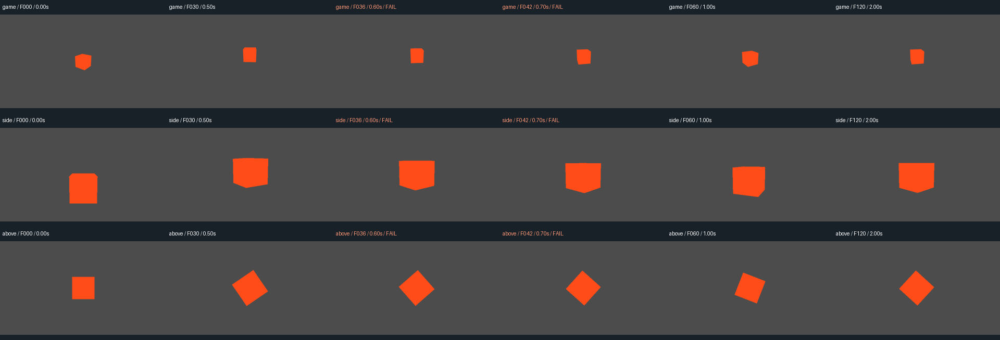
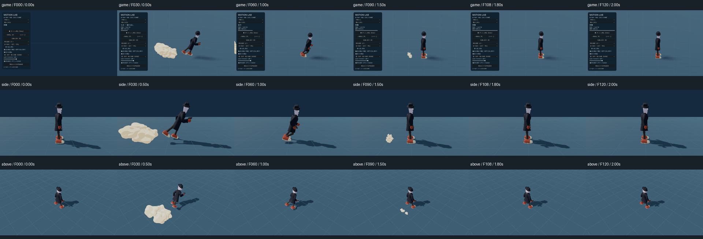

# Godot の一括確認と確認資料の圧縮（2026-10-11）

操作・コマ送り・同時刻の多方向撮影・数値確認を一度の要求にまとめた。全画像はローカルに保存し、通常の確認には代表時点の一覧と異常箇所の拡大だけを渡す。

## 比較結果

同じ常駐 Godot で、個別要求と一括要求を交互の順番で5組、逐次実行した。各条件の中央値。

| 指標 | 個別操作・全画像を渡す | 一括操作・代表画像を渡す |
|---|---:|---:|
| 操作から確認資料生成まで | 5.254秒 | 2.225秒 |
| Godot への要求 | 44回 | 1回 |
| 結果 JSON の文字数 | 27,315文字 | 968文字 |
| 確認用画像数 | 63枚 | 2枚 |
| 確認用画像の総画素数 | 14,515,200 | 1,366,272 |

この条件で処理待ちは約58%短縮。文字数・画像量はトークン数の代用指標であり、実際のモデルの入力トークン・推論トークン・料金は計測していない。個別側でも結果を手動で選べば画像量は減らせる。一括側の利点は、その選択と要約を毎回自動で行える点にある。

## 計測条件

- 開始: 2026-10-11 16:35:39 JST。Windows 11、Python 3.12.10、Godot 4.7.2 stable、Vulkan Forward+、GeForce RTX 4060。
- 画面外で起動し、実ウィンドウを非表示にした専用ワーカー。同じ PID を再利用。両経路をウォームアップしてから計測。
- テスト用の動く立方体を120物理コマ進め、6コマごとに21時点×3方向を撮影。保存画像は640×360。ゲーム画面の内部解像度は1600×900を維持。
- 個別側はロード1回・コマ送り20回・プロパティ変更2回・同期撮影21回。一括側は同じ処理を1回の `review` 要求で実行。
- 両経路ともロード・操作・PNG の読み戻しと保存・一覧と拡大画像の生成を計測に含む。初回起動・ウォームアップ・画像照合・AI の画像処理や判断時間は除外。
- 全時点の数値測定が一致し、5組×63枚＝315枚の対応画像がピクセル単位で完全一致。
- 意図的に足底位置を36コマで −0.20m に変更し、60コマで戻す。許容0.03mの判定で異常が検出され、代表時点の選択と拡大画像に残った。これは検出器用の人工的な異常で、実キャラクターの不具合画像ではない。

[各試行の生データ](compact-review-2026-10-11.json)




## 実際の走りモーションでの確認

`motion_dash.json` を CLI から実行し、既存のモーションラボの `start_trial` を通常速度で再生した。ゲーム画面・横・上の3方向を同じ停止コマで撮影。対象はその時点の作業ツリーにあるラボの既定キャラクターで、本編側の制作途中の変更も含む。

- 0〜120コマを6コマ間隔で撮影、21時点・63枚。処理と一覧生成は3.195秒（起動時間を除く）。
- 一覧は0・30・60・90・108・120コマの6時点、1枚に集約。全63枚の PNG と数値記録はローカルに保持。
- 測定した足底の最小高さは地面から約0.002m。許容範囲を外れた測定は0件。
- 煙の同時所属数の上限確認は通過し、最後の測定時点では0個。
- エンジンのエラー・警告抜粋は0行。全21時点で各方向の物理コマ番号が一致。非表示ウィンドウ、マウス非捕捉も確認。
- 開始・走行・停止・煙の消失を一覧画像で目視確認した。動画の通常速度再生を視聴したという検証ではない。



## 関連検証と限界

`python -m unittest discover -s tools/tests -p "test_dev*.py"`：実エンジンを使う関連4テストが11.296秒で成功。

既存の更新・入力・正確なコマ送り・非表示撮影に加えて、操作直後の位置変更がそのコマの画像へ反映されること、入力を押し直さず復元すること、異常検出・代表時点選択、対象消失や途中失敗からの復帰、無効な時刻指定をロード前に拒否することを確認した。接続用トークンを撮影記録に保存しないことも検証した。今回の変更に無関係なゲーム全体のテストは繰り返していない。

数値チェックは撮影と操作の時点だけで行うため、間のコマの異常は保証しない。足底判定は明示した固定の地面高さとの比較で、起伏や動く床への追従は対象外。ラボの1キャラクターの確認であり、全キャラクターの足の検証ではない。描画のランダム表現やカメラ依存の見え方は、今回の決定的な比較とは条件が異なる。

## 使用方法

```powershell
python tools/dev_session.py --name review start --mode render
python tools/dev_session.py --name review review godot/addons/dev_session/scenarios/motion_dash.json --output tools/diagnostics/dash-review
python tools/dev_session.py --name review stop
```

起動済みなら中央のコマンドだけを繰り返す。`summary.json` と `contact.png` を通常の確認に使い、問題がある場合に `manifest.json`、元の PNG、エンジンログを追加で読む。

```powershell
python tools/benchmark_dev_review.py --pairs 5
```

[アドオンの仕様とシナリオの作り方](../../godot/addons/dev_session/README.md)
