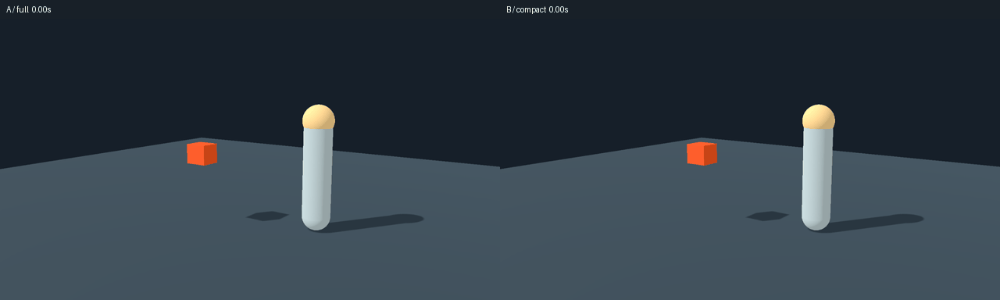

# パンチVFX：同じ依頼で通常確認と圧縮確認を比較

2026-10-11。確認処理は短くなったが、今回の制作全体では時間・実測トークンは減らなかった。共通の細かい撮影を使った盲検では同点。1組だけなので、制作方式の一般的な優劣や品質維持の保証には使わない。



## 条件

独立した2担当に[同じ制作依頼](punch-ab-brief.md)を渡した。両方とも `gpt-6.1-sol / high`、もう一方のコード・画像を見ない。同じ撮影台、シード431、60Hz、等速、23時点×3方向、640×360。GPU描画はロックで逐次実行し、待ち時間を分離した。

- A：各時点を個別要求で撮影、全23時点を3枚の一覧で確認。
- B：1要求で撮影し、ピーク・主動作・退出を指定した8時点の一覧で確認。曖昧な細部は元PNGを追加で開く。
- 両方とも全時点の元PNGを保存。制作後は同じ46時点×3方向、800×450で別撮影。レビュー担当には方式を伏せてX/Yの画像を渡した。

今回の「通常」はエディタを開く手作業ではなく、個別RPC＋全時点確認である。両案とも常駐セッションを使っており、常駐化の効果までBだけの利益に数えない。

## 実測

| 項目 | A 通常 | B 圧縮 |
|---|---:|---:|
| 制作の経過時間 | 395秒 | 422秒 |
| 撮影回数（失敗も含む） | 5 | 7 |
| 1回の確認処理・中央値 | 4.367秒 | 2.011秒 |
| 1回のRPC数 | 48 | 2 |
| 最終回の返却JSON文字数 | 30,393 | 1,150 |
| 報告された実読画像数 | 19 | 41 |
| 実読画像の元画素数 | 26,035,200 | 18,109,440 |
| GPUロック待ち・合計 | 3.413秒 | 0秒 |
| 新規入力トークン | 83,365 | 85,886 |
| キャッシュ入力トークン | 1,577,088 | 1,778,816 |
| 出力トークン（推論を含む） | 12,350 | 14,479 |

確認処理は約54%短縮、返却文字数は約96%減少。元画素数は追加確認を含めても約30%減った。一方、制作全体はBが約7%長く、新規入力は約3%、出力は約17%増えた。Bはピークと退出の細部を追加で見たうえで修正したため、「小さい一覧だけで済む」という想定にはならなかった。

トークンは担当ごとのCodexログの最後の `token_count.info.total_token_usage` から取得した。新規入力は `input_tokens - cached_input_tokens`。キャッシュ入力は入力の内数、推論出力は出力の内数。総入力はA 1,660,453、B 1,864,702。画像の元画素数と返却文字数はトークンの代用値であり、トークンそのものではない。実読画像の列挙は担当の記録に基づく。

これは2担当の制作分だけ。親のツール実装・準備・共通撮影・盲検担当のトークンは含めず、タスク全体や請求額として扱わない。共通撮影と一覧生成は11.379秒だった。大きな共通コンテキストとやり取りの回数も総トークンに影響するため、返却JSONを96%減らしても総トークンが96%減るわけではない。

両担当ともシェーダーの古いキャッシュに遭遇し、同じ技術上の注意を受けた。Aのcycle_01はシェーダー変更未反映、Bのcycle_00はシェーダー構文エラー、cycle_01は古いキャッシュ。これらも実コストとして残した。作者の設計・デバッグ差、修正回数、初回コンパイルの差が交絡するので、経過時間から方式だけの因果効果を断定しない。

## 品質確認

方式を伏せた担当の採点。X=B、Y=A。この対応は採点終了後に開示した。

| 項目（5点満点） | A | B |
|---|---:|---:|
| 殴打の読みやすさ | 4 | 4 |
| 前進方向 | 4 | 4 |
| 形の変形と時間差 | 3 | 3 |
| 厚み／3方向 | 2 | 2 |
| 人物と比べた大きさ | 4 | 4 |
| 終わり方 | 4 | 4 |
| 合計 | 21 | 21 |

画像から断定できる重大な仕様違反は両案ともなかった。Aはクリームの芯と退出の順序が安定して読め、Bは太い輪郭が仕様に近い。僅差の好みではAだったが、明確な品質差とは評価されなかった。

共通の弱点はF12〜F26（0.200〜0.433秒）で板状の星に見え、厚みと部位ごとの追従が弱いこと。BはF14→F16で芯が隠れ、F22〜F24で戻る。Aは完成した星形を保持する時間が長い。圧縮による品質低下はこの比較では検出できなかったが、両案とも改善余地がある。

盲検担当と親は静止コマ列を確認した。GIFは同じ撮影から30fps相当の等速で組み立てた確認用プレビューで、最後に0.7秒の休止を付けた。動画を等速で視聴して評価したという主張ではない。描画ログは両案ともエラー0、46時点の数値異常0、1.3秒以降の残存VFXノード0。ノード確認は画像とは別にエンジン側で実行した。

## 今回追加した最適化

- `key_frames`：短いヒットのピークと退出を必ず一覧に残し、予想外の数値異常用にも1枠を確保。無効な指定はエンジン要求前に拒否。
- `.gdshader` の再読み込み：キャッシュされたShaderを直接更新し、使用中のマテリアルに反映する。色が変わること、Shader・Mesh・PIDが同じことを実描画テストで確認。
- `watch`：GDScriptとShaderを監視し、`.godot`などを走査前に除外。

シェーダー再読み込みは今回の制作で見つかった問題を受けて親が後から追加した。A/B制作時の時間短縮としては数えていない。シェーダー構文エラーの自動復元はなく、次の描画ログを確認する。個別生成した非キャッシュShaderには適用されないため、シーンの再読み込みを使う。

## 使い方と検証

`godot/punch_vfx_lab.tscn` が比較Lab。`1 / 2`で案を選択、`Space`で再生、`Tab`で3方向を切替。2秒ごとに等速で再生する。既存の本編シーンを変更せず、両案の `spawn(parent, pos, size, direction)` を本編から呼べる状態で残した。

```powershell
tools/godot/Godot_v4.7.2-stable_win64_console.exe --path godot res://punch_vfx_lab.tscn
python tools/punch_workflow_trial.py --mode compact --variant b --effect res://vfx/punch_trial_b/punch.gd --iteration 7
python tools/punch_workflow_trial.py --mode compact --variant b --effect res://vfx/punch_trial_b/punch.gd --stop
python tools/punch_trial_audit.py
python -m unittest discover -s tools/tests -p "test_dev*.py"
```

関連テスト7本成功（15.850秒）。Labの両案選択・視点切替・自動再生を隠れた描画セッションで確認し、エラー0。セッションは確認後に停止した。フルゲームテストは、本編ロジックを変更していないため繰り返していない。

詳細数値・盲検結果は [punch-ab-results.json](punch-ab-results.json)。全撮影とログはローカルの `tools/diagnostics/punch-ab/` に保存し、Gitには比較GIFと集計を保存する。
